  

  
  

<h2 align="center">About</h2>

  I build web applications and APIs, with a focus on C#/.NET backends and JavaScript/TypeScript experiences.
  I enjoy turning practical ideas into useful products and learning through hands-on projects.

  
  
  
  
  
  

<h2 align="center">Selected Work</h2>

<table>
  <tr>
    <td width="50%" valign="top">
      <h3><a href="https://github.com/Bekzod2809/pyro">HotSync</a></h3>
      
A NASA Space Apps Challenge 2026 project by Team Capella in Tashkent. HotSync harmonizes MODIS and VIIRS wildfire observations to make fire-count comparisons fair across years and regions.

      
Python · JavaScript · NASA Earth data

    </td>
    <td width="50%" valign="top">
      <h3><a href="https://github.com/Bekzod2809/AstroMuseum3D">AstroMuseum 3D</a></h3>
      
An interactive, multilingual solar-system museum with 3D planet models and a cinematic web interface.

      
TypeScript · 3D web · Multilingual UI

    </td>
  </tr>
  <tr>
    <td width="50%" valign="top">
      <h3><a href="https://github.com/Bekzod2809/grpc-books-microservices">Books gRPC Microservices</a></h3>
      
A .NET learning project exploring service-to-service communication with gRPC and Protocol Buffers.

      
C# · .NET · gRPC · REST

    </td>
    <td width="50%" valign="top">
      <h3><a href="https://github.com/Bekzod2809/movie-catalog-minimal-api">Movie Catalog API</a></h3>
      
A layered CRUD REST API built with ASP.NET Core Minimal API, DTOs, and a service layer.

      
C# · .NET · ASP.NET Core · OpenAPI

    </td>
  </tr>
</table>

<h2 align="center">A Milestone</h2>

  <strong>NASA Space Apps Challenge 2026 · Tashkent · Team Capella</strong> 
  My first hackathon: collaborating on a NASA data project, solving problems as a team, and bringing an idea to life.

  

<em>Curious by nature. Building one project at a time. ✦</em>

